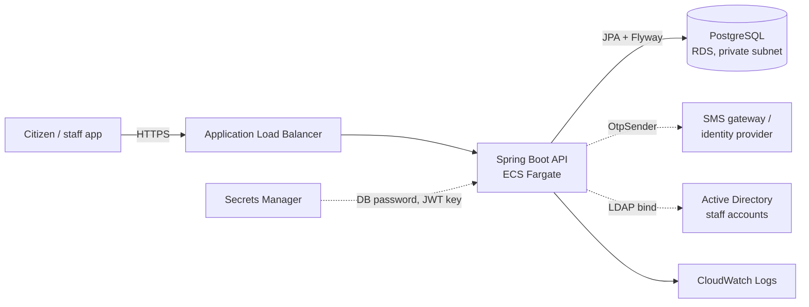

# Citizen Services API

[](https://github.com/coldworld22/citizen-services-api/actions/workflows/ci.yml)
[](https://github.com/coldworld22/citizen-services-api/actions/workflows/codeql.yml)


[](LICENSE)

A backend for government e-services, modelled on the citizen portals I built for a Saudi regional government. Citizens sign in with a one-time code, submit requests (building permits, business licences, certificates, complaints) and follow them, while staff sign in with their Active Directory accounts to review and decide them. Every sign-in and every decision lands in an audit trail.

The point of the project is the parts that matter in public-sector systems: identity, access control, a strict workflow, traceability, and infrastructure that can be rebuilt from code.

## Features

- **Passwordless sign-in** with a national or residence ID and a 6-digit one-time code, the same pattern as Nafath or SMS OTP. Codes are hashed with BCrypt, expire after 5 minutes, allow 5 wrong guesses, and are rate limited per ID. Unknown IDs get the same response as real ones, so the endpoint can't be used to find registered users.
- **Active Directory sign-in for staff** over LDAP. The directory checks the password; the application decides the role, so a directory account alone grants nothing. Usernames are escaped against LDAP injection, blank passwords are refused (an empty LDAP bind can succeed anonymously), and both outcomes are audited.
- **Role-based access** for `CITIZEN`, `EMPLOYEE`, `SUPERVISOR` and `ADMIN`, enforced per endpoint with signed JWTs.
- **Request workflow as a state machine:** `SUBMITTED → IN_REVIEW → APPROVED / REJECTED`, or `SUBMITTED → CANCELLED`. Illegal moves return `409 Conflict`; rejections need a written reason.
- **Data isolation:** citizens only ever see their own requests. Asking for someone else's returns `404`, so request IDs can't be probed.
- **Audit trail:** who did what, to which record, when and from which IP. It's written in the same transaction as the change, so a rolled-back change never leaves an audit entry.
- **Optimistic locking**, so two supervisors can't silently overwrite each other's decision.
- **Hardened HTTP:** strict Content-Security-Policy, no-referrer and frame denial on every response, plus a per-IP rate limit on sign-in.
- **RFC 7807 error responses**, OpenAPI docs and Swagger UI, and health probes for the load balancer.

Security choices are mapped against the OWASP Top 10 in [docs/SECURITY.md](docs/SECURITY.md), and the query indexes are measured on 300,000 requests in [docs/PERFORMANCE.md](docs/PERFORMANCE.md).

## Architecture



```
src/main/java/.../eservices
├── auth/      OTP challenge, sign-in service, JWT issuing
├── request/   service request entity, state machine, workflow service, REST API
├── audit/     audit events, recording service, admin search API
├── user/      users, roles, the signed-in Actor
├── config/    security, JWT keys, OpenAPI, clock
└── common/    error handling, paging
```

## Run it locally

You need Docker.

```bash
cp .env.example .env
# put a real key in .env:  JWT_SECRET=$(openssl rand -base64 32)
docker compose up --build
```

Then open http://localhost:8080/swagger-ui.html.

The local setup runs in demo mode: the API returns the one-time code in its response instead of sending it by SMS. Five demo accounts are created:

| National ID | Role |
|---|---|
| `1000000001` | Citizen |
| `2000000005` | Citizen (resident) |
| `1000000002` | Employee |
| `1000000003` | Supervisor |
| `1000000004` | Admin |

### Try the full flow with curl

```bash
API=http://localhost:8080/api/v1

login() {  # usage: login <national-id>
  code=$(curl -s -X POST $API/auth/otp/request -H 'Content-Type: application/json' \
    -d "{\"nationalId\":\"$1\"}" | jq -r .devCode)
  curl -s -X POST $API/auth/otp/verify -H 'Content-Type: application/json' \
    -d "{\"nationalId\":\"$1\",\"code\":\"$code\"}" | jq -r .accessToken
}

CITIZEN=$(login 1000000001); EMPLOYEE=$(login 1000000002)
SUPERVISOR=$(login 1000000003); ADMIN=$(login 1000000004)

# Citizen submits a request
ID=$(curl -s -X POST $API/requests -H "Authorization: Bearer $CITIZEN" -H 'Content-Type: application/json' \
  -d '{"type":"BUILDING_PERMIT","title":"Second floor","description":"Adding 120 m2 to the family house."}' | jq -r .id)

# Employee takes it, supervisor approves it
curl -s -X POST $API/requests/$ID/assign -H "Authorization: Bearer $EMPLOYEE" | jq .status
curl -s -X POST $API/requests/$ID/decision -H "Authorization: Bearer $SUPERVISOR" \
  -H 'Content-Type: application/json' -d '{"decision":"APPROVE","note":"Plans comply."}' | jq .status

# Admin reads the audit trail for that request
curl -s "$API/audit?entityId=$ID" -H "Authorization: Bearer $ADMIN" | jq '.items[].action'
```

## API

| Method | Path | Who | What |
|---|---|---|---|
| `POST` | `/api/v1/auth/otp/request` | anyone | Send a one-time code |
| `POST` | `/api/v1/auth/otp/verify` | anyone | Exchange the code for a token |
| `POST` | `/api/v1/auth/staff/login` | staff | Sign in with an Active Directory username and password |
| `POST` | `/api/v1/requests` | citizen | Submit a request |
| `GET` | `/api/v1/requests` | signed in | Own requests (citizen) or all of them (staff); filter by `status` |
| `GET` | `/api/v1/requests/{id}` | owner or staff | One request |
| `POST` | `/api/v1/requests/{id}/assign` | employee, supervisor | Take a request for review |
| `POST` | `/api/v1/requests/{id}/decision` | supervisor | Approve or reject |
| `POST` | `/api/v1/requests/{id}/cancel` | owner | Cancel before review |
| `GET` | `/api/v1/audit` | admin | Search by `entityId` or `actorId` |

The full contract is at `/v3/api-docs` while the app is running.

## Tests

```bash
mvn verify
```

The integration tests start a real PostgreSQL 16 with Testcontainers and an in-memory LDAP directory in place of Active Directory, and go through the API exactly as a client would: both sign-in methods, the full approval flow, role checks, data isolation, the attempt limit on codes, and the audit trail. CI also builds the Docker image and validates the Terraform on every push.

### Connecting Active Directory

Staff sign-in talks to any LDAP directory. For Active Directory, set:

| Variable | Example |
|---|---|
| `LDAP_URL` | `ldaps://dc01.example.gov.sa:636` |
| `LDAP_BASE` | `DC=example,DC=gov,DC=sa` |
| `LDAP_USER_BASE` | `OU=Staff` |
| `LDAP_USERNAME_ATTRIBUTE` | `sAMAccountName` (the default) |
| `LDAP_BIND_DN` / `LDAP_BIND_PASSWORD` | a read-only service account used to look users up |

Then link each staff member's app account to their directory login in `users.directory_username`. The demo data links `employee1`, `supervisor1` and `admin1`.

## Deploy to AWS

`infra/terraform` builds the whole environment:

- a VPC with public subnets for the load balancer and API, and private subnets for the database
- an Application Load Balancer, with HTTPS when you give it an ACM certificate
- ECS Fargate running the container, with a deployment circuit breaker that rolls back failed releases
- RDS PostgreSQL 16, encrypted, with its password generated and kept in Secrets Manager
- the JWT key in Secrets Manager, injected into the task at start-up
- ECR with image scanning, and CloudWatch logs
- an IAM role GitHub Actions assumes via OIDC, so no AWS keys are stored in GitHub

```bash
cd infra/terraform
cp terraform.tfvars.example terraform.tfvars
terraform init
terraform apply
```

Then in the GitHub repository, set the variable `AWS_DEPLOY_ROLE_ARN` to the `github_deploy_role_arn` output and run the **Deploy to AWS** workflow. It builds the image, pushes it to ECR and rolls out new tasks.

**Cost:** with one small task and a `db.t4g.micro` database, expect roughly 50–60 USD a month, mostly the load balancer, the database and the Fargate task. Set `desired_count = 0` to stop the API, or `terraform destroy` to remove everything.

## Design decisions

- **Why OTP, not passwords?** Government portals in Saudi Arabia sign people in through Nafath or SMS codes, not passwords. `OtpSender` is an interface, so a real SMS gateway or identity provider replaces the logging sender without touching the sign-in logic.
- **Why does the directory not decide roles?** In most organisations, AD groups are managed by IT for many systems at once. Keeping roles in the application means a group change elsewhere can't silently make someone a supervisor here, and every role change stays visible in one place.
- **Why a state machine on the enum?** The allowed transitions live in one place (`RequestStatus`) and the entity refuses illegal moves itself. No controller or service can skip a step by mistake.
- **Why audit in the same transaction?** An audit trail that can disagree with the data is worse than none. `AuditService.record` requires an existing transaction (`Propagation.MANDATORY`), so it can't be called outside one.
- **Why 404 instead of 403 for other people's requests?** A 403 confirms the request exists. Returning 404 gives away nothing.
- **Why HMAC-signed JWTs?** There is one service issuing and checking tokens, so a shared secret is simpler than a key pair. With several services, it would move to RS256 and a published key set.
- **Why no NAT gateway?** Tasks pull images over public IPs, and their security group only accepts traffic from the load balancer. That saves about 35 USD a month for a demo. In production, tasks would sit in private subnets behind a NAT gateway or VPC endpoints.

## License

MIT
